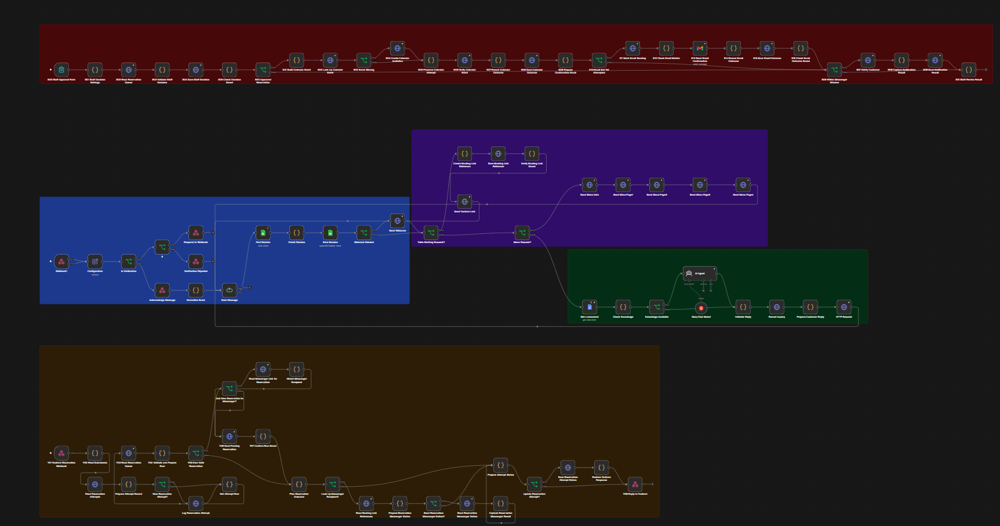

# Arya’s Cafe | Customer support and reservations

An n8n pilot for a café using Messenger. Ask for hours or directions, request menu images, or request a table. The bot replies in English or natural Taglish. A reservation is pending until staff approve it.

## Workflow overview

The n8n workflow handles Messenger inquiries and menu requests, processes Youform reservation submissions, and sends confirmations after staff approval.

[](./Aryas_Cafe_Workflow_screenshot.png)

*Click the screenshot to open it at full size and read the node labels.*

## Setup in three steps

1. **Prepare the accounts and data.** Use an n8n workspace, a Meta Page and app with Messenger access, a Groq credential, and Google Docs, Sheets, Gmail, and Calendar credentials. Create an approved customer knowledge Doc and a workbook using the headers below. Create a Youform reservation form with a hidden `booking_ref` URL field and required questions labeled exactly `Number of guests`, `Guest name`, `Mobile number`, `Email address`, `Reservation date`, `Arrival time`, and `AM or PM`. Use a Date field and separate 12-hour time and AM/PM dropdowns. Upload the menu images as reusable Messenger attachments for your Page.
2. **Import and configure.** Import `Aryas_Cafe_Workflow_Template.json` inactive. Set the Doc ID, workbook ID, verify token, and four attachment IDs in **Configuration**. Set the workbook ID in **Y02 Read Submission**, **Create Booking Link Reference**, and **S01 Staff Decision Settings**. Set the intended calendar in S01. Set your Youform slug wherever `YOUR_YOUFORM_SLUG` appears (Y02, Send Youform Link, and Prepare Reservation Messenger Notice). Select the workbook and Sessions tab in **Find Session** and **Save Session**. Select credentials on the nodes: Meta Page token in an Authorization header credential, separate Header Auth for Y01, Basic Auth for S00, Google OAuth credentials for Sheets, Gmail and Calendar, a Google Docs service account with viewer access, and Groq. Choose a new verification token and matching Youform header secret. Keep both private.
3. **Connect and verify.** Publish the workflow and register **Webhook1**’s production callback in Meta with the matching verify token. Point Youform’s standard v2 webhook at **Y01**’s production POST URL with its configured header. Give authorized staff the private **S00** production URL. Send a test inquiry, request a fresh Messenger booking link, submit with an email you control, approve, and verify both Messenger notices plus email and Calendar delivery. When replacing a workflow with the same webhook paths, deactivate the old version before activating the replacement.

### Workbook headers (paste in row 1)

```text
Sessions
session_key	last_message_at

Inbox
received_at	message_id	session_key	inquiry	draft_reply	action	reason	status	resolution

ReservationLinks
token	page_id	sender_id	received_at	language

ReservationAttempts
submission_id	received_at	reference	status	notification

Reservations
reservation_id	created_at	session_key	page_id	sender_id	guest_name	phone	date	time	party_size	status	source_message_id	last_customer_at	staff_note	decided_at	notification_status	notification_message_id	email	dining_minutes	calendar_event_id	calendar_status	email_status	email_message_id	calendar_event_link	integration_error
```

## How it works

| Trigger | Flow | Result |
|---|---|---|
| Messenger text | Verify/acknowledge → normalize → session greeting → route by intent | Menu images or a linked booking form. Other questions use Google Docs and Groq, validate JSON reply/action/reason, log in Inbox, and send the reply. |
| Youform submission | Authenticate → log attempt → parse Manila date and AM/PM → validate and check matches → save | Valid new requests enter Reservations as pending. Invalid slots stay out of the queue and get a Messenger explanation if linked and eligible. Pending edits update arrival time and guest count on the original row. |
| Staff decision | Authenticate → load exactly one reservation → save decision → deliver notifications | Approval attempts Calendar, Gmail, and linked Messenger confirmation. The sheet records each outcome. |

The booking reference in the form URL links back to the Messenger thread and preferred reply language. The form date is stored as YYYY-MM-DD and arrival time as HH:MM. Customers see AM/PM in Messenger. The workflow checks one to eight guests, two hours of notice, a 30-day booking window, and a 90-minute visit before closing. Staff verify actual seating availability.

## Operator runbook

- **Review inquiries.** Filter Inbox for open handoffs. Verify availability, allergens, payment, or order status before replying. Record the outcome in the resolution column.
- **Approve or decline.** Review the pending row and actual seating availability. Copy the full reservation ID from Reservations column A into the private staff form, choose the decision, enter your name, and select yes for availability checked when approving.
- **Verify delivery.** Check Reservations columns P, U, and V for Messenger, Calendar, and email. Use the matching n8n run to diagnose failures. Check ReservationAttempts for pending receipts and invalid-slot notices. An approved row records the decision even if a delivery fails.
- **Recover carefully.** Use retry_notifications for a decided booking when a channel needs a retry. If Gmail status is send_unknown, check Sent first. Reset V to not_sent only after verifying no message was sent. For an expired or unlinked Messenger conversation, use the recorded email or follow up manually. Avoid blindly rerunning an append after an ambiguous write.
- **Resolve conflicting matches.** Verify the intended booking before changing any rows. Keep one active record for the same date and normalized name, email, and phone. Approved bookings require staff review for changes.
- **Maintain.** Edit approved facts in Google Docs. Keep the staff form, workbook, credentials, tokens, and customer data private. Test changes on controlled accounts before publishing.

## Limits

Sheets read-then-write checks handle sequential duplicates. Concurrent writes and staff edits can still race. No automatic seating allocation, approved booking amendments, or live stock verification. Messenger delivery depends on a valid link and an eligible conversation. Direct form submissions still support approval by email and Calendar. Live credentials and account permissions must be configured after import.

## Reviewer quick start

Unzip the handoff and run `node run-sample.cjs` with Node.js. No packages, accounts, or secrets are needed. The script runs the actual n8n Code node bodies against fictional form and sheet data. It exercises a pending receipt, pending edit, approval text, approved duplicate, same-ID replay, and invalid-slot notice. Google Sheets and Messenger responses are simulated. Use the setup guide above for the live integration path.

This export can be submitted privately. The live Arya’s Cafe Page and form remain the demonstration deployment. A different café uses its own Page, menu attachments, Youform, and connected accounts. The template includes example placeholders for those values.
